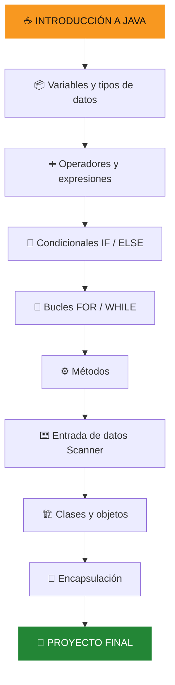

<div align="center">


<br/>

**De cero a tu primer proyecto de programación.**

Un curso introductorio, práctico y visual para descubrir el mundo de la programación utilizando Java.

<br/>


<br/>

**🎯 Aprende · 💻 Practica · 🚀 Construye**

</div>

---

## 📌 Sobre el proyecto

**Fundamentos de Java para Principiantes** es un curso educativo diseñado para introducir a estudiantes de secundaria, entre 12 y 17 años, al mundo de la programación.

A través de 10 lecciones en video, aprenderás progresivamente los conceptos esenciales de Java, desde mostrar tu primer mensaje en pantalla hasta desarrollar un pequeño sistema de gestión de estudiantes.

El contenido utiliza ejemplos cotidianos, explicaciones sencillas y ejercicios prácticos para que cualquier persona pueda comenzar a programar sin experiencia previa.

### ✨ ¿Qué encontrarás?

- 🎥 10 videos educativos con explicaciones paso a paso.
- 💻 Ejemplos de código Java comentados.
- 🧩 Ejercicios para poner en práctica lo aprendido.
- 🌐 Editores online para programar sin instalaciones.
- 📚 Recursos adicionales y buenas prácticas.
- 🚀 Un proyecto final que integra los conocimientos del curso.

<div align="center">

### ¡No necesitas instalar nada!

**Solo necesitas un navegador y ganas de aprender.**

</div>

---

## 📊 Información del curso

| Característica | Descripción |
|---|---|
| 🎓 Institución | Universidad Peruana de Ciencias Aplicadas (UPC) |
| 📚 Curso | 1ASI0729 - Desarrollo de Aplicaciones Open Source |
| 🔢 NRC | 7729 |
| 📅 Período académico | 2026-20 |
| 💻 Lenguaje | Java |
| 🎯 Nivel | Principiante |
| 👥 Público objetivo | Estudiantes de 12 a 17 años |
| 🎬 Cantidad de videos | 10 |
| ⏱️ Duración total | 64 minutos |
| 📖 Prerrequisitos | Ninguno |

---

## 🗺️ Ruta de aprendizaje

Este curso está organizado para avanzar desde los conceptos más básicos hasta la construcción de un programa funcional.



---

## 🎥 Contenido del curso

**10 lecciones · 64 minutos · Aprendizaje progresivo**

| # | Lección | Duración | Contenido |
|:---:|---|:---:|---|
| 01 | ☕ ¿Qué es programar y qué es Java? | 6 min | Introducción a la programación y Hola Mundo |
| 02 | 📦 Variables y tipos de datos | 6 min | int, double, String, boolean y char |
| 03 | ➕ Operadores y expresiones | 6 min | Operadores aritméticos, comparación y lógica |
| 04 | 🔀 Decisiones con if y else | 6 min | Condicionales y juego de adivinanza |
| 05 | 🔁 Bucles: repetir tareas | 7 min | while, for y tablas de multiplicar |
| 06 | ⚙️ Métodos y reutilización | 6 min | Parámetros, métodos y return |
| 07 | ⌨️ Entrada de datos con Scanner | 6 min | Lectura de datos desde el teclado |
| 08 | 🏗️ Clases y objetos | 7 min | POO, atributos, constructores y objetos |
| 09 | 🔐 Encapsulación, getters y setters | 6 min | Protección de atributos y validaciones |
| 10 | 🚀 Proyecto final y buenas prácticas | 8 min | Sistema de Gestión de Estudiantes |

### 🎬 Acceso a las lecciones

Cada lección incluye su código fuente y espacio para incorporar el video correspondiente.

| Lección | Código fuente | Video |
|---|---|---|
| 01 | [`lesson-01-intro`](lessons/lesson-01-intro/) | [Ver en YouTube](https://youtu.be/f9UBns556O8) |
| 02 | [`lesson-02-variables`](lessons/lesson-02-variables/) | [Ver en YouTube](https://youtu.be/1UwLN9UL6Ys) |
| 03 | [`lesson-03-operadores`](lessons/lesson-03-operadores/) | [Ver en YouTube](https://youtu.be/r5D_MPz-eQ0) |
| 04 | [`lesson-04-if-else`](lessons/lesson-04-if-else/) | [Ver en YouTube](https://youtu.be/fHbGM7QOj6w) |
| 05 | [`lesson-05-bucles`](lessons/lesson-05-bucles/) | [Ver en YouTube](https://youtu.be/KNgEEadHqNo) |
| 06 | [`lesson-06-metodos`](lessons/lesson-06-metodos/) | [Ver en YouTube](https://youtu.be/ZCcfhX2RsE0) |
| 07 | [`lesson-07-scanner`](lessons/lesson-07-scanner/) | [Ver en YouTube](https://youtu.be/95yDCkvMk1A) |
| 08 | [`lesson-08-clases-objetos`](lessons/lesson-08-clases-objetos/) | [Ver en YouTube](https://youtu.be/Fh1-v7lX85s) |
| 09 | [`lesson-09-encapsulacion`](lessons/lesson-09-encapsulacion/) | [Ver en YouTube](https://youtu.be/YdSRAi8mRyg) |
| 10 | [`lesson-10-proyecto-final`](lessons/lesson-10-proyecto-final/) | [Ver en YouTube](https://youtu.be/a4WN0YVYjRE) |

---

## 🛠️ Herramienta de desarrollo

Durante todo el curso utilizaremos una única plataforma para escribir, ejecutar, probar y depurar nuestros programas en Java.

<div align="center">

### ☕ OnlineGDB — Online Java Compiler

<a href="https://www.onlinegdb.com/online_java_compiler">
  
</a>

**[Ingresar al compilador de Java](https://www.onlinegdb.com/online_java_compiler)**

</div>

### ¿Qué podemos hacer con OnlineGDB?

- ✍️ Escribir y editar código Java desde el navegador.
- ▶️ Compilar y ejecutar nuestros programas.
- 🐞 Depurar programas para identificar errores.
- 🔍 Observar la ejecución paso a paso.
- 📊 Revisar variables y puntos de interrupción.
- 💻 Practicar sin instalar un entorno de desarrollo local.

**Importante:** Todos los ejercicios, ejemplos y actividades prácticas del curso se desarrollarán utilizando OnlineGDB.

---

## 📂 Estructura del repositorio

La organización del proyecto permite encontrar rápidamente las lecciones, ejemplos, ejercicios y documentación.

```text
java-fundamentals-course/
│
├── 📄 README.md
│
├── 📁 lessons/
│   ├── 📁 lesson-01-intro/
│   ├── 📁 lesson-02-variables/
│   ├── 📁 lesson-03-operadores/
│   ├── 📁 lesson-04-if-else/
│   ├── 📁 lesson-05-bucles/
│   ├── 📁 lesson-06-metodos/
│   ├── 📁 lesson-07-scanner/
│   ├── 📁 lesson-08-clases-objetos/
│   ├── 📁 lesson-09-encapsulacion/
│   └── 📁 lesson-10-proyecto-final/
│
├── 📁 starter-files/
│   └── Ejercicios iniciales
│
├── 📁 completed-examples/
│   ├── 📁 mini-projects/
│   └── 📁 best-practices/
│
├── 📁 resources/
│   ├── cheatsheet.md
│   ├── guia-instalacion-local.md
│   ├── ejercicios-extra.md
│   └── links-utiles.md
│
├── 📁 scripts/
│   ├── compile-all.sh
│   └── run-tests.sh
│
├── 📁 docs/
│   ├── plan-de-curso.md
│   ├── rubrica.md
│   └── participacion.md
│
├── 📄 .gitignore
├── 📄 LICENSE
└── 📄 CONTRIBUTING.md
```

---

## 🧪 Proyecto final: Sistema de Gestión de Estudiantes

<div align="center">


</div>

Como cierre del curso, desarrollarás un pequeño sistema de gestión de estudiantes que integra los principales conceptos aprendidos.

### Funcionalidades

- 👤 Registrar información de un estudiante.
- 📝 Agregar notas y validar sus valores.
- 📊 Calcular el promedio de calificaciones.
- 📋 Mostrar información del estudiante.
- 🎓 Determinar si está aprobado o desaprobado.
- 🚪 Gestionar las opciones mediante un menú interactivo.

### Conceptos aplicados

| Concepto | Aplicación |
|---|---|
| Clases y objetos | Clase `Estudiante` |
| Encapsulación | Atributos privados |
| Getters y setters | Acceso y validación |
| Arrays | Almacenamiento de notas |
| Métodos | Operaciones reutilizables |
| Scanner | Entrada de información |
| While | Repetición del menú |
| Switch | Selección de opciones |
| If / Else | Validaciones y estados |

---

## 📚 Recursos adicionales

Continúa aprendiendo con los materiales disponibles en el repositorio.

| Recurso | Descripción |
|---|---|
| 📄 [Cheatsheet](resources/cheatsheet.md) | Referencia rápida de Java |
| 💡 [Buenas prácticas](completed-examples/best-practices/) | Recomendaciones para escribir código limpio |
| 🐛 [Errores comunes](completed-examples/best-practices/errores-comunes.md) | Problemas frecuentes y cómo reconocerlos |
| 🧩 [Ejercicios adicionales](resources/ejercicios-extra.md) | Actividades para reforzar conocimientos |
| 🔗 [Enlaces útiles](resources/links-utiles.md) | Documentación y herramientas |
| 📖 [Plan del curso](docs/plan-de-curso.md) | Organización académica |

### 🚀 ¿Qué aprender después?

Al completar las diez lecciones, puedes continuar con:

- Herencia y polimorfismo.
- Colecciones y ArrayList.
- Manejo de excepciones.
- Interfaces gráficas.
- Desarrollo de aplicaciones.

---

## 👥 Equipo de desarrollo

**Universidad Peruana de Ciencias Aplicadas (UPC)**

Curso: **1ASI0729 – Desarrollo de Aplicaciones Open Source**  
NRC: **7729** · Período: **2026-20**

| Lecciones | Rama |
| --- | --- |
| 1 y 2 | `lecciones-01-02` |
| 3 y 4 | `lecciones-03-04` |
| 5 y 6 | `lecciones-05-06` |
| 7 y 8 | `lecciones-07-08` |
| 9 y 10 | `lecciones-09-10` |

### 🤝 Trabajo colaborativo

El proyecto se desarrolla mediante Git y GitHub, utilizando ramas individuales, commits descriptivos y Pull Requests para integrar los aportes del equipo.

Consulta las [ramas asignadas](docs/participacion.md) y la [guía de contribución](CONTRIBUTING.md).

---

## 📈 Filosofía de aprendizaje

```text
01. Aprende un concepto.
       ↓
02. Observa un ejemplo.
       ↓
03. Escribe tu propio código.
       ↓
04. Ejecuta y comprueba.
       ↓
05. Identifica y corrige errores.
       ↓
06. Construye algo nuevo.
```

**La programación no se aprende solamente leyendo código: se aprende escribiéndolo, probándolo y mejorándolo.**

---

## 📜 Licencia

Este proyecto está distribuido bajo la licencia MIT. Consulta el archivo [LICENSE](LICENSE) para conocer los términos de uso.

---

## ⭐ ¡Gracias por visitar este proyecto!

Si este repositorio te ayuda a dar tus primeros pasos en Java, considera dejar una estrella ⭐ y compartirlo con otros estudiantes.

<div align="center">


<br/>

**JAVA FUNDAMENTALS · 2026**

*De principiante a creador de soluciones.*

</div>
